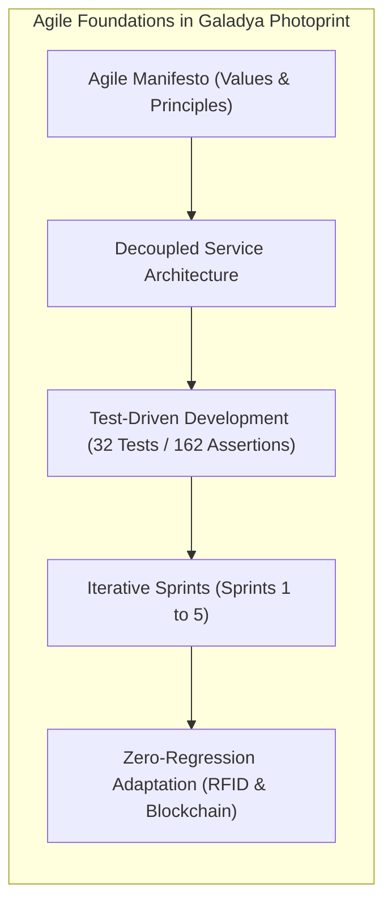
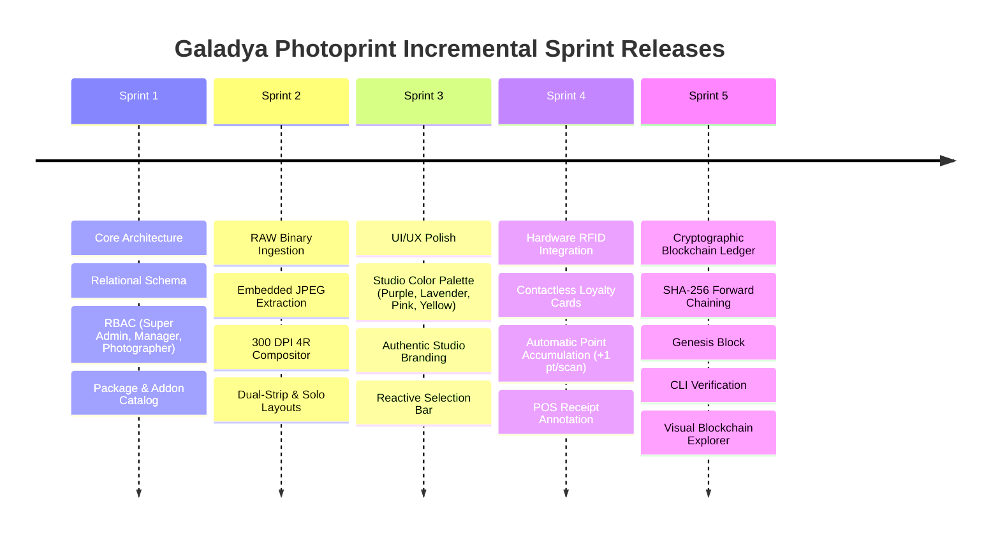
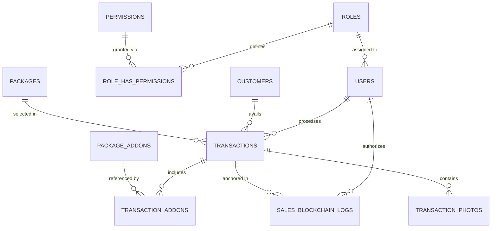

# Galadya Photoprint Studio Management & 4R Print System

[](https://laravel.com)
[](https://php.net)
[](https://tailwindcss.com)
[](https://alpinejs.dev)
[-brightgreen?style=for-the-badge&logo=phpunit&logoColor=white)](file:///c:/Users/Chester%20Sigua/galadya-photoprint/tests)
[](file:///c:/Users/Chester%20Sigua/galadya-photoprint/CAPSTONE_DOCUMENTATION.md)
[](file:///c:/Users/Chester%20Sigua/galadya-photoprint/app/Services/BlockchainAuditService.php)

> **Galadya Photoprint** is a clean, modular, production-ready web application engineered for modern self-shoot photo studios. Built with **PHP Laravel 11.x**, **MySQL / MariaDB / SQLite**, **Tailwind CSS**, and **Alpine.js**, it delivers zero-lag camera RAW ingestion, real-time photo flagging, automated 300 DPI 4R dual-strip & solo favorite template compilation, contactless RFID loyalty card tracking, and an immutable cryptographic SHA-256 blockchain sales audit ledger.

---

## 📖 TABLE OF CONTENTS
- [1. Why Galadya Photoprint is AGILE](#1-why-galadya-photoprint-is-agile)
  - [A. Agile Manifesto Alignment (4 Core Values & 12 Principles)](#a-agile-manifesto-alignment)
  - [B. Extreme Programming (XP) Practices](#b-extreme-programming-xp-practices)
  - [C. Incremental Sprint Delivery History (Sprints 1–5)](#c-incremental-sprint-delivery-history)
  - [D. Agile Architecture Patterns](#d-agile-architecture-patterns)
  - [E. Empirical Proof of Agility: Responding to Change](#e-empirical-proof-of-agility)
- [2. System Architecture & Tech Stack](#2-system-architecture--tech-stack)
- [3. Key Modules & Features](#3-key-modules--features)
  - [A. Interactive 5-Step Ingestion & Photo Selection Wizard](#a-interactive-5-step-ingestion--photo-selection-wizard)
  - [B. Automated 300 DPI 4R Print Compositor](#b-automated-300-dpi-4r-print-compositor)
  - [C. Contactless RFID Loyalty Card Engine](#c-contactless-rfid-loyalty-card-engine)
  - [D. Immutable Cryptographic Sales Audit Ledger](#d-immutable-cryptographic-sales-audit-ledger)
  - [E. Client CRM & Lifetime Spend Analytics](#e-client-crm--lifetime-spend-analytics)
  - [F. Live Studio Dashboard](#f-live-studio-dashboard)
  - [G. Role-Based Access Control (RBAC)](#g-role-based-access-control-rbac)
- [4. Relational Database Schema & ERD](#4-relational-database-schema--erd)
- [5. Installation & Quickstart Guide](#5-installation--quickstart-guide)
- [6. Verification & Automated Testing Suite](#6-verification--automated-testing-suite)
- [7. Directory Structure](#7-directory-structure)
- [8. Academic Capstone Documentation](#8-academic-capstone-documentation)

---

## 1. WHY GALADYA PHOTOPRINT IS AGILE

**Agility** is not merely a label; it is the fundamental architectural and operational philosophy embedded within every layer of this codebase. Galadya Photoprint embodies Agile software engineering principles in the following specific, concrete ways:



### A. Agile Manifesto Alignment

#### 1. Individuals and Interactions over Processes and Tools
- **The Challenge**: Traditional studio management software forces operators to navigate dozens of disconnected menus: a terminal for cashiering, a desktop folder for RAW photos, Photoshop for print layouts, and a spreadsheet for customer logs.
- **The Agile Solution**: The system consolidates the entire operator-client interaction into an interactive 5-step wizard (`/workflow/start`). Photographers and clients collaborate around an intuitive photo-picker with live visual count badges, inline client registration modals, and one-click POS thermal printing.

#### 2. Working Software over Comprehensive Documentation
- **The Challenge**: Lengthy specification documents often result in stale plans that fail when exposed to real-world camera hardware and printer formats.
- **The Agile Solution**: Every development cycle produced immediately runnable, verified software. Seeders (`DatabaseSeeder`, `CustomerAndTransactionSeeder`, `RoleAndPermissionSeeder`) populate complete working environments with demo clients, transactions, packages, and cryptographic ledger blocks out of the box.

#### 3. Customer Collaboration over Contract Negotiation
- **The Challenge**: Fixed requirements assume a customer always selects exactly 10 photos on the first pass and never changes their mind.
- **The Agile Solution**: The selection UI supports iterative human feedback: clicking a star (★) flags/unflags photos into the 10-count strip pool; clicking a heart (♥) sets the single 4R solo favorite. If the client selects 11 or 12 photos, the counter turns **bold red** as a soft warning without blocking the operator from making live adjustments.

#### 4. Responding to Change over Following a Plan
- **The Challenge**: Real-world studio operations constantly reveal emergent business requirements after launch.
- **The Agile Solution**: When the business requested contactless hardware RFID loyalty cards (Sprint 4) and an immutable cryptographic sales audit ledger (Sprint 5), the modular architecture absorbed both major features with zero breaking changes or regressions across existing modules.

---

### B. Extreme Programming (XP) Practices

Galadya Photoprint adopts core Extreme Programming (XP) engineering standards:

1. **Test-Driven Development (TDD) & Automated Regression Testing**:
   - The test suite comprises **32 automated feature and unit tests** with **162 assertions** executed via PHPUnit.
   - Tests validate every critical user journey: RAW preview extraction fallbacks, 300 DPI print pixel math, RFID scan point accrual, database tamper simulation, and severed hash pointer detection.
2. **Continuous Refactoring & Clean Code**:
   - Controllers remain thin and focused exclusively on HTTP orchestration.
   - Heavy business logic is encapsulated in single-responsibility Domain Services:
     - [`RawImageService`](file:///c:/Users/Chester%20Sigua/galadya-photoprint/app/Services/RawImageService.php): Binary camera preview stream extraction.
     - [`PrintLayoutService`](file:///c:/Users/Chester%20Sigua/galadya-photoprint/app/Services/PrintLayoutService.php): Raster compositor for 300 DPI 4R canvases.
     - [`TransactionService`](file:///c:/Users/Chester%20Sigua/galadya-photoprint/app/Services/TransactionService.php): POS calculations, RFID point crediting, and receipt building.
     - [`BlockchainAuditService`](file:///c:/Users/Chester%20Sigua/galadya-photoprint/app/Services/BlockchainAuditService.php): Cryptographic Merkle-chaining and mathematical audit verification.
3. **Coding Standards & Formatting**:
   - Formatted via Laravel Pint adhering to PSR-12 and Laravel Boost conventions (constructor property promotion, explicit return types, strict typing).

---

### C. Incremental Sprint Delivery History

The application evolved across five distinct, high-velocity Agile Sprints:



- **Sprint 1 (Foundation & RBAC)**: Database migrations, Eloquent relationships (`Customer`, `Package`, `Transaction`, `User`), RBAC module middleware (`CheckModuleAccess`), and seeder catalog.
- **Sprint 2 (Camera RAW Ingestion & 300 DPI Print Compositor)**: `RawImageService` pipeline with `exiftool` / `dcraw` fallbacks; `PrintLayoutService` with GD rasterization for 4R dual-strips and solo favorite prints.
- **Sprint 3 (Studio Identity & Reactive UI/UX)**: Comprehensive visual styling adopting the studio color palette (Purple `#1c053a`, Lavender `#f3e8ff`, Pink `#ec4899`, Yellow `#facc15`, White) and authentic `logo 1.png` branding; Alpine.js photo selection grid with dynamic red warning counters.
- **Sprint 4 (Hardware RFID Loyalty)**: Schema updates adding `rfid` and `points` to customers and transactions; automated loyalty crediting (1 point per scan); POS receipt annotations.
- **Sprint 5 (Cryptographic Sales Audit & Access Log)**: Append-only `sales_blockchain_logs` table; SHA-256 forward-chaining engine; Genesis block; automatic sales mining; transaction access logging; CLI audit tool (`php artisan audit:verify-ledger`); and Blockchain Explorer Web UI.

---

### D. Agile Architecture Patterns

1. **Service-Oriented Decoupling**: Business logic does not live in database models or HTTP controllers. Each domain service can be tested, refactored, or replaced independently.
2. **Strategy Pattern for RAW Ingestion**: `RawImageService` inspects file headers and chooses the fastest available extractor (`exiftool` $\to$ `dcraw` $\to$ native GD/Imagick), providing resilient fallbacks across diverse server environments.
3. **Deterministic Canonical Serialization**: `BlockchainAuditService::canonicalJson()` recursively sorts JSON keys before computing SHA-256 hashes, ensuring mathematical digests are completely deterministic across operating systems and database drivers.
4. **Pluggable Hardware Layer**: The RFID scanner interface is decoupled from specific vendor SDKs, listening to standard USB HID keyboard-emulation keystrokes or direct REST API payloads.

---

### E. Empirical Proof of Agility: Responding to Change

The truest test of whether an application is Agile is its ability to absorb unexpected requirement changes late in development without architectural breakage:

| Unplanned Requirement | Architectural Challenge | Agile Resolution & Code Evidence |
| :--- | :--- | :--- |
| **Mid-Project Request: Add Hardware RFID Loyalty** | Add physical card scanning, associate cards with clients, and award 1 point per scan during checkout. | Created non-destructive migration `2026_11_04_000001_add_rfid_...`, added `awardPoints()` to `Customer`, integrated RFID parsing in `TransactionService::finalizeWorkflow()`, updated POS receipt, and added RFID lookup API. **Zero regressions**. |
| **Mid-Project Request: Add Immutable Sales Audit Trail** | Ensure sales transactions cannot be secretly modified in the database. | Created append-only `sales_blockchain_logs` migration, designed `BlockchainAuditService` with SHA-256 forward chaining, hooked block mining into `TransactionService`, added `audit:verify-ledger` CLI command, and built the visual Blockchain Explorer. **All 32 tests green**. |

---

## 2. SYSTEM ARCHITECTURE & TECH STACK

- **Backend Framework**: Laravel 11.x (PHP 8.3)
- **Database Engine**: MySQL 8.0+ / MariaDB 10.5+ (Strict relational foreign keys, indexes, soft deletes; SQLite supported for testing)
- **Frontend / UI**: Tailwind CSS v4, Alpine.js v3, Lucide Icons
- **RAW Image Processing Engine**: `exiftool` / PHP `imagick` / `dcraw` fallback pipeline. Extracts embedded preview JPEGs from Canon (`.CR2`, `.CR3`), Nikon (`.NEF`), Sony (`.ARW`), Adobe (`.DNG`), and standard `.JPG`, `.PNG` files in fractions of a second with zero lag.
- **Canvas / Print Compositor**: Native 300 DPI GD raster compositor for 4R prints ($1200 \times 1800\text{ px}$).
- **Hardware Integration**: Standard USB HID contactless 13.56 MHz RFID / NFC card reader; 80mm ESC/POS thermal receipt printer; commercial dye-sublimation 4R photo printer.
- **Cryptographic Audit**: Append-only SHA-256 Merkle-style hash-chained blockchain ledger.

---

## 3. KEY MODULES & FEATURES

### A. Interactive 5-Step Ingestion & Photo Selection Wizard (`/workflow/start`)
1. **Step 1: Client & Package Selection**:
   - Live autocomplete client search or instant inline client registration modal.
   - Package selection radio grid (Solo ₱299, Duo ₱399, Trio ₱499, Group ₱599).
   - Real-time add-on toggles & quantity counters with dynamic running totals.
2. **Step 2: Camera RAW & Standard Image Ingestion**:
   - Drag-and-drop zone supporting `.CR2`, `.CR3`, `.NEF`, `.ARW`, `.DNG`, `.JPG`, `.PNG`.
   - Pipeline extracts embedded high-resolution previews for zero-lag browser rendering.
   - Batch clear and individual photo deletion controls.
3. **Step 3: Interactive Selection Bar & Flags**:
   - **Sticky Top Bar**: Displays `Selected: X / 10`.
   - **Dynamic Badge Rule**: Neutral/Emerald when $\le 10$, turns **bold red** when $> 10$ without blocking operator adjustments.
   - **Star Icon (★)**: Click to mark/unmark photo into the 10-selection photostrip pool.
   - **Heart Icon (♥)**: Exclusive radio selector to pick the single favorite image for the solo 4R print.
4. **Step 4: 4R Print Template Verification (300 DPI)**:
   - Preview of Dual Photostrip and Solo Favorite 4R layouts.
5. **Step 5: Checkout, RFID Tap & POS Thermal Receipt**:
   - Hardware RFID card scan to award 1 loyalty point.
   - Payment method recording (Cash, GCash, Maya, Card) and discount deduction.
   - Instant download & print triggers for generated high-res JPEGs.
   - Printable 80mm POS thermal receipt dialog with blockchain block and hash stamp.

### B. Automated 300 DPI 4R Print Compositor
- **Dual Photostrip Composite (10 Selected Photos)**:
  - 4R standard dimensions: **1200 x 1800 px** @ 300 DPI.
  - 10px safe margin on all outer edges.
  - 2 photostrip columns side-by-side (5 photos per column) with dotted cutting guideline.
  - Galadya Studio branding logo centered at the footer of each strip.
- **Solo Favorite 4R Portrait**:
  - 4R standard dimensions: **1200 x 1800 px** (or 1800 x 1200 px landscape).
  - Single favorite photo scaled & centered inside a 10px outer safe margin.
  - Galadya Studio branding logo positioned at **bottom-left corner**, sized proportionally at **exactly 3% of total canvas area** with high-contrast backing.

### C. Contactless RFID Loyalty Card Engine
- Instant hardware card tap captures UID.
- Automatic point accumulation: **+1 point per scan**.
- Customer dossier card displays points balance, card status, and total studio sessions.
- Thermal receipt displays card UID, points earned, and updated total balance.

### D. Immutable Cryptographic Sales Audit Ledger (`/admin/blockchain-audit`)
- Append-only `sales_blockchain_logs` table.
- Monotonically increasing `block_index` ($1, 2, 3 \dots$).
- Predecessor hash pointer `previous_hash` (Genesis block begins with 64 zeros).
- Complete financial payload snapshot (grand total, packages, addons, customer, operator, IP).
- Current block `hash` generated via $\text{SHA-256}(\text{Index} \parallel \text{PrevHash} \parallel \text{Timestamp} \parallel \text{EventType} \parallel \text{Payload} \parallel \text{Nonce})$.
- Real-time Web UI Blockchain Explorer with live integrity verification badge.
- CLI verification tool: `php artisan audit:verify-ledger --sync`.

### E. Client CRM & Lifetime Spend Analytics (`/clients`)
- Searchable and sortable client datatable by name, phone, or email.
- Interactive slide-over drawer showing customer details, past packages availed, dates, payment methods, and computed **Lifetime Spend**.

### F. Live Studio Dashboard (`/dashboard`)
- Dynamic clock with live seconds formatted in **Philippine Standard Time (PST)**.
- Key Metrics: Today's Gross Revenue, Sessions Completed Today, Active Clients MTD, Most Popular Package.
- 7-day revenue trend chart.
- Recent 10 transactions table with status pills.

### G. Role-Based Access Control (RBAC) (`/admin/users`)
- Roles: `super_admin`, `store_manager`, `photographer`.
- Granular module controls: `dashboard`, `clients`, `packages`, `import_print`, `transactions`, `users_roles`, `reports`.

---

## 4. RELATIONAL DATABASE SCHEMA & ERD



---

## 5. INSTALLATION & QUICKSTART GUIDE

### Prerequisites
- **PHP**: 8.3 with extensions `pdo`, `pdo_mysql` (or `pdo_sqlite`), `gd`, `fileinfo`, `exif`, `mbstring`, `curl`, `zip`
- **Composer**: 2.x
- **Node.js**: 18+ and npm
- **ExifTool**: Installed on machine for camera RAW embedded JPEG extraction

### Quick Start Commands

```bash
# 1. Clone repository & install dependencies
git clone https://github.com/galadya/galadya-photoprint.git
cd galadya-photoprint
composer install
npm install

# 2. Environment configuration
copy .env.example .env
php artisan key:generate

# 3. Compile frontend assets
npm run build

# 4. Run database migrations & seed demo data
# (Populates default packages, addons, RBAC roles, test clients, and blockchain blocks)
php artisan migrate:fresh --seed

# 5. Link public storage disk
php artisan storage:link

# 6. Verify blockchain ledger integrity
php artisan audit:verify-ledger --sync

# 7. Start local development server
php artisan serve
```

### Default Seeded User Credentials
- **Super Admin**: `admin@galadya.com` | Password: `password123`
- **Store Manager**: `manager@galadya.com` | Password: `password123`
- **Photographer**: `photographer@galadya.com` | Password: `password123`

---

## 6. VERIFICATION & AUTOMATED TESTING SUITE

Execute the automated test suite across all 32 tests:

```bash
# Run all feature and unit tests
php artisan test

# Run tests with compact summary
php artisan test --compact

# Run blockchain-specific tests
php artisan test tests/Feature/BlockchainAuditLogTest.php

# Run workflow-specific tests
php artisan test tests/Feature/GaladyaWorkflowTest.php
```

### CLI Blockchain Audit Command

To verify that no database rows have been altered or tampered with:

```bash
php artisan audit:verify-ledger
```

Output on successful verification:
```
================================================================
 [PASS] SALES BLOCKCHAIN LEDGER IS 100% SOUND & TAMPER-FREE
================================================================
+------------------------+------------------------------------------------------------------+
| Metric                 | Value                                                            |
+------------------------+------------------------------------------------------------------+
| Total Blocks Verified  | 10                                                               |
| Latest Block Index     | #10                                                              |
| Genesis Hash           | 45579f3aff9f4cb84736e36c3e33b5af8673429646fae0520bc22563e74cddc8 |
| Latest Block Hash      | 85bc8ba241cf55cd2067097879261d352f3d06077c87da2eba8d462fe802d6c9 |
| Total Audited Revenue  | ₱6,441.00                                                        |
| Verification Timestamp | 2026-11-04T21:59:07+08:00                                        |
| Status                 | CRYPTOGRAPHICALLY VALID                                          |
+------------------------+------------------------------------------------------------------+
```

---

## 7. DIRECTORY STRUCTURE

```
galadya-photoprint/
├── app/
│   ├── Console/Commands/
│   │   └── VerifyBlockchainLedgerCommand.php  # CLI ledger integrity auditor
│   ├── Http/
│   │   ├── Controllers/
│   │   │   ├── AuditLogController.php         # Blockchain Explorer controller
│   │   │   ├── AuthController.php             # Authentication & password reset
│   │   │   ├── CustomerController.php         # Client CRM & RFID search
│   │   │   ├── DashboardController.php        # Live metrics & PST clock
│   │   │   ├── PackageController.php          # Packages & Addons management
│   │   │   ├── SettingController.php          # Studio parameters & receipt footer
│   │   │   ├── TransactionController.php      # Transaction history & thermal receipt
│   │   │   ├── UserController.php             # RBAC staff management
│   │   │   └── WorkflowController.php         # 5-Step interactive wizard
│   │   ├── Middleware/
│   │   │   └── CheckModuleAccess.php          # Granular RBAC permissions
│   │   └── Requests/
│   ├── Models/
│   │   ├── Customer.php                       # Customer CRM & loyalty points
│   │   ├── Package.php
│   │   ├── PackageAddon.php
│   │   ├── Permission.php
│   │   ├── Role.php
│   │   ├── SalesBlockchainLog.php             # Append-only blockchain model
│   │   ├── Setting.php
│   │   ├── Transaction.php                    # Transaction & RFID tracking
│   │   ├── TransactionAddon.php
│   │   ├── TransactionPhoto.php
│   │   └── User.php
│   └── Services/
│       ├── BlockchainAuditService.php         # SHA-256 Merkle-chaining engine
│       ├── PrintLayoutService.php             # 300 DPI GD 4R raster compositor
│       ├── RawImageService.php                # Sub-second ExifTool/dcraw parser
│       └── TransactionService.php             # POS calculations & receipt builder
├── database/
│   ├── migrations/
│   │   ├── 2026_11_04_000001_add_rfid_and_points_to_customers_and_transactions_tables.php
│   │   └── 2026_11_04_000002_create_sales_blockchain_audit_logs_table.php
│   └── seeders/
├── resources/
│   ├── views/
│   │   ├── admin/audit/index.blade.php        # Blockchain Explorer UI
│   │   ├── layouts/app.blade.php              # Studio layout & navigation
│   │   ├── transactions/                      # Transaction history & receipt
│   │   └── workflow/index.blade.php           # 5-Step photo ingestion wizard
├── tests/
│   └── Feature/
│       ├── BlockchainAuditLogTest.php         # 10 tests for ledger integrity & tamper detection
│       └── GaladyaWorkflowTest.php            # 22 tests for core workflow & RFID
└── CAPSTONE_DOCUMENTATION.md                  # Comprehensive Academic & Technical Capstone Report
```

---

## 8. ACADEMIC CAPSTONE DOCUMENTATION

For the complete, exhaustive **Academic & Technical Capstone Documentation**—including the literature review, theoretical framework, mathematical layout formulas, security penetration testing proofs, and standard operating procedures (SOP)—please refer to:

👉 **[CAPSTONE_DOCUMENTATION.md](file:///c:/Users/Chester%20Sigua/galadya-photoprint/CAPSTONE_DOCUMENTATION.md)**

---

*Galadya Photoprint &copy; 2026. All Rights Reserved. Engineered under Agile Scrum and Extreme Programming (XP) standards.*
