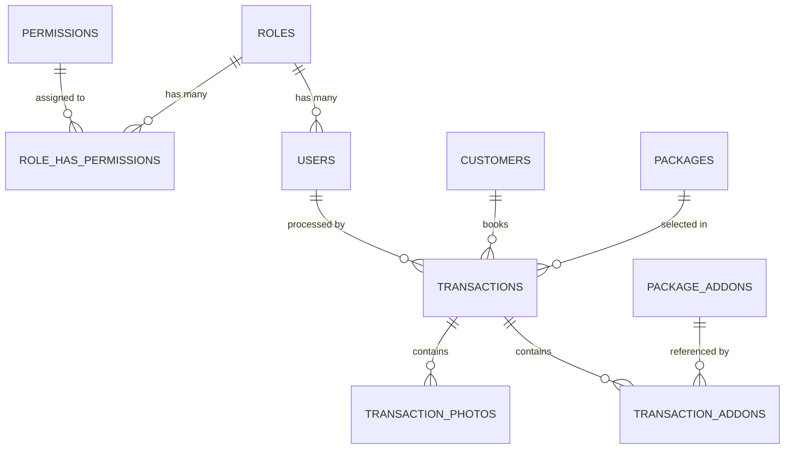

# Galadya Photoprint Studio Management & 4R Print System

**Galadya Photoprint** is a clean, modular, and production-ready web application built for modern self-shoot photo studios. Engineered with **PHP Laravel 11.x**, **MySQL / MariaDB**, **Tailwind CSS**, and **Alpine.js**, it features zero-lag camera RAW ingestion, real-time photo flagging, automated 300 DPI 4R dual-strip & solo favorite template compilation, client CRM with lifetime spend tracking, and POS thermal receipt generation.

---

## 1. System Architecture & Tech Stack

- **Backend Framework**: Laravel 11.x (PHP 8.2+)
- **Database Engine**: MySQL 8.0+ / MariaDB 10.5+ (Strict relational foreign keys, indexes, soft deletes, SQLite fallback supported)
- **Frontend / UI**: Tailwind CSS v4, Alpine.js v3, Lucide Icons
- **RAW Image Processing Engine**: `exiftool` / PHP `imagick` / `dcraw` fallback pipeline. Extracts embedded preview JPEGs from Canon (`.CR2`, `.CR3`), Nikon (`.NEF`), Sony (`.ARW`), Adobe (`.DNG`), and standard `.JPG`, `.PNG` files in fractions of a second with zero lag.
- **Canvas / Print Processing**: Intervention Image v3 + Native 300 DPI GD raster compositor for 4R prints (1200 x 1800 px).

---

## 2. Key Modules & Features

### A. Role-Based Access Control (RBAC)
- **Roles**:
  - `super_admin`: Full system, user management, settings, financial audit, and workflow operations.
  - `store_manager`: Daily studio operations, client CRM, packages, and transaction reports.
  - `photographer`: Self-shoot booth operator, RAW ingestion, photo selection, and 4R printing.
- **Default Seeded Accounts**:
  - Super Admin: `admin@galadya.com` | Password: `password123`
  - Store Manager: `manager@galadya.com` | Password: `password123`
  - Lead Operator: `photographer@galadya.com` | Password: `password123`

### B. Interactive 5-Step Ingestion & Photo Selection Wizard (`/workflow/start`)
1. **Step 1: Client & Package Selection**:
   - Live autocomplete client search or instant inline client registration popup.
   - Package selection radio grid (Solo ₱299, Duo ₱399, Trio ₱499, Group ₱599).
   - Real-time add-on toggles & quantity counters with dynamic running totals.
2. **Step 2: Camera RAW & Standard Image Ingestion**:
   - Drag-and-drop zone supporting `.CR2`, `.CR3`, `.NEF`, `.ARW`, `.DNG`, `.JPG`, `.PNG`.
   - Pipeline extracts embedded high-resolution previews for zero-lag browser rendering.
3. **Step 3: Interactive Selection Bar & Flags**:
   - **Sticky Top Bar**: Displays `Selected: X / 10`.
   - **Dynamic Badge Rule**: Neutral/Emerald when `count <= 10`, turns **bold red** when `count > 10` without hard-blocking operator adjustments.
   - **Star Icon (★)**: Click to mark/unmark photo into the 10-selection photostrip pool.
   - **Heart Icon (♥)**: Exclusive radio selector to pick the single favorite image for the solo 4R print.
4. **Step 4: Automated 4R Print Template Generation (300 DPI)**:
   - **Output A (Photostrip Composite - 10 Selected Photos)**:
     - 4R standard dimensions: **1200 x 1800 px** @ 300 DPI.
     - 10px safe margin on all outer edges.
     - 2 photostrip columns side-by-side (5 photos per column) with dotted cutting guideline.
     - Galadya Studio branding logo centered at the footer of each strip.
   - **Output B (Solo Favorite 4R Print)**:
     - 4R standard dimensions: **1200 x 1800 px** (or 1800 x 1200 px landscape).
     - Single favorite photo scaled & centered inside a 10px outer safe margin.
     - Galadya Studio branding logo positioned at **bottom-left corner**, sized proportionally at **exactly 3% of total canvas area** with high-contrast backing.
5. **Step 5: Finalization & POS Receipt**:
   - Payment method recording (Cash, GCash, Maya, Card).
   - Instant download & print triggers for generated high-res JPEGs.
   - Printable 80mm POS thermal receipt dialog.

### C. Client CRM & Loyalty Database (`/clients`)
- Searchable and sortable client datatable by name, phone, or email.
- Interactive slide-over drawer showing:
  - Customer contact details & notes.
  - Number of availed sessions.
  - List of past packages availed, dates, payment methods, and computed **Lifetime Spend**.

### D. Live Studio Dashboard (`/dashboard`)
- Dynamic clock with live seconds formatted in **Philippine Standard Time (PST)** and business terminal status.
- Key Metrics: Today's Gross Revenue, Sessions Completed Today, Active Clients MTD, Most Popular Package.
- 7-day revenue trend chart.
- Recent 10 transactions table with status indicators.

---

## 3. Database Schema Overview



---

## 4. Installation & Setup Guide

### Prerequisites
- PHP 8.2 or 8.3 with extensions: `pdo`, `pdo_mysql` (or `pdo_sqlite`), `gd`, `fileinfo`, `exif`, `mbstring`, `curl`, `zip`
- Composer 2.x
- Node.js 18+ & npm
- `exiftool` (installed on machine for camera RAW embedded JPEG extraction)

### Quick Start Commands

```bash
# 1. Clone repository & install composer dependencies
composer install

# 2. Install frontend dependencies & build assets
npm install
npm run build

# 3. Environment configuration
copy .env.example .env
php artisan key:generate

# 4. Configure Database in .env
# For MySQL: set DB_CONNECTION=mysql, DB_DATABASE=galadya_photoprint, etc.
# For SQLite (default out of the box):
# php artisan migrate:fresh --seed

# 5. Link public storage disk
php artisan storage:link

# 6. Run the local development server
php artisan serve
```

### Running the Test Suite

```bash
php artisan test --filter=GaladyaWorkflowTest
```

---

## 5. Default Catalog Pricing (Configured in Seeders)

### Packages
- **Solo Self Shoot**: ₱299.00 (15 min, 1 pax, wireless remote, 4R dual-strip + solo 4R)
- **Duo Self Shoot**: ₱399.00 (20 min, 2 pax, props, 4R dual-strip + solo 4R)
- **Trio Self Shoot**: ₱499.00 (25 min, 3 pax, accessories, 4R dual-strip + solo 4R)
- **Group Self Shoot**: ₱599.00 (30 min, up to 5 pax, unlimited captures, 4R dual-strip + solo 4R)

### Add-on Services
- **Photographer**: ₱300.00
- **Extra 15 Minutes**: ₱100.00
- **Extra Pax**: ₱100.00
- **Extra Pet**: ₱100.00

---

## 6. Directory Structure

```
galadya-photoprint/
├── app/
│   ├── Http/
│   │   ├── Controllers/
│   │   │   ├── AuthController.php
│   │   │   ├── CustomerController.php
│   │   │   ├── DashboardController.php
│   │   │   ├── PackageController.php
│   │   │   ├── SettingController.php
│   │   │   ├── TransactionController.php
│   │   │   ├── UserController.php
│   │   │   └── WorkflowController.php
│   │   ├── Middleware/
│   │   │   └── CheckModuleAccess.php
│   │   └── Requests/
│   │       ├── LoginRequest.php
│   │       ├── StoreAddonRequest.php
│   │       ├── StoreCustomerRequest.php
│   │       ├── StorePackageRequest.php
│   │       └── StoreTransactionWorkflowRequest.php
│   ├── Models/
│   │   ├── Customer.php
│   │   ├── Package.php
│   │   ├── PackageAddon.php
│   │   ├── Permission.php
│   │   ├── Role.php
│   │   ├── Setting.php
│   │   ├── Transaction.php
│   │   ├── TransactionAddon.php
│   │   ├── TransactionPhoto.php
│   │   └── User.php
│   └── Services/
│       ├── PrintLayoutService.php
│       ├── RawImageService.php
│       └── TransactionService.php
├── database/
│   ├── migrations/
│   └── seeders/
├── public/
│   ├── images/
│   │   ├── galadya-logo.png
│   │   ├── galadya-logo-light.png
│   │   └── galadya-logo.svg
│   └── storage/ -> storage/app/public/
├── resources/
│   ├── css/app.css
│   ├── js/app.js
│   └── views/
│       ├── admin/users/
│       ├── auth/
│       ├── customers/
│       ├── dashboard/
│       ├── layouts/
│       ├── packages/
│       ├── settings/
│       ├── transactions/
│       └── workflow/
├── routes/
│   └── web.php
└── tests/
    └── Feature/GaladyaWorkflowTest.php
```

---
*Galadya Photoprint &copy; 2026. Built with Laravel 11, Tailwind CSS, and Alpine.js.*
